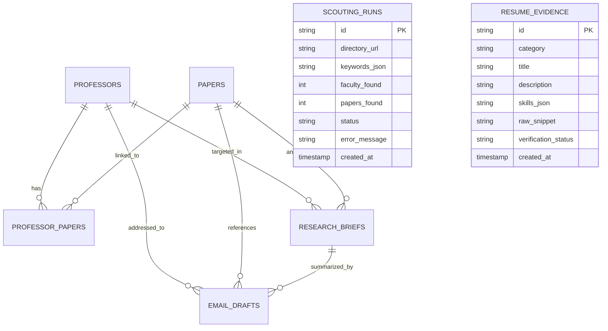

# A.R.T.E.M.I.S. — Master Project Handoff & Architecture Guide
**Autonomous Research Tracking, Exploration, Matching & Intelligent Scouting**

- **Date**: October 29, 2026
- **Current Version**: 0.4.0 (Milestones 1–4 Complete)
- **Repository**: [https://github.com/piyushSahooDB/ARTEMIS](https://github.com/piyushSahooDB/ARTEMIS)
- **Test Suite Status**: 118 Unit & Integration Tests Passed (0 Failed, 1 Skipped — Live Web Smoke Test)
- **Primary Runtime Interface**: Local Web Dashboard via Streamlit (`app.py`) + Modular CLI (`artemis`)

---

## 1. Executive Summary & Project Purpose

**A.R.T.E.M.I.S.** is a local-first Python research assistant built to help university students discover prospective research advisors, comprehend their recent academic publications, connect those papers to authentic qualifications from their résumé, and prepare personalized, review-ready cold email drafts.

### Core Philosophy & Non-Negotiable Constraints
1. **Local-First & Light**: Everything persists locally in SQLite with WAL mode and foreign key constraints. No external vector databases, microservices, Docker, or heavyweight multi-agent frameworks.
2. **Strict Anti-Hallucination**: Faculty details, publication records, email addresses, and student qualifications are **never fabricated**. Missing data is left as `None` or explicitly flagged as `UNVERIFIED`.
3. **Audited Provenance**: Every entity and assertion records source URLs, extraction timestamps, and grounding evidence snippets.
4. **Review-Only Outreach**: The system only prepares drafts. Emails are **never sent automatically**. The user retains complete manual review and sending control.
5. **Separation of Relevance and Identity**: Paper relevance to keywords is strictly distinguished from confidence in author identity. Name-only matches without institutional affiliation remain marked uncertain.

---

## 2. System Architecture & Directory Map

```text
ARTEMIS/
├── .env.example                  # Environment configuration template
├── .gitignore                    # Exclusion rules for local DBs, venvs, and secrets
├── .streamlit/                   # Streamlit configuration (dark theme, localhost binding)
│   └── config.toml
├── app.py                        # Streamlit dashboard root entrypoint
├── pyproject.toml                # PEP 517/621 package metadata & dependencies
├── README.md                     # High-level overview & quickstart guide
├── HANDOFF.md                    # This master project handoff document
├── src/
│   └── artemis/
│       ├── __init__.py           # Package exports
│       ├── cli.py                # Subcommands: scout, ingest-resume, brief, draft, match
│       ├── service.py            # ArtemisScoutingService orchestration
│       ├── models/               # Pydantic v2 domain schemas with validation & provenance
│       │   ├── __init__.py       # Model exports
│       │   ├── common.py         # VerificationStatus enum and SourceProvenance model
│       │   ├── professor.py      # Professor entity with email validation and URLs
│       │   ├── paper.py          # Paper entity (DOI, arXiv, OpenAlex)
│       │   ├── resume.py         # ResumeEvidence entity with raw_snippet & UNVERIFIED state
│       │   ├── brief.py          # ResearchBrief with limitations, gaps, and open questions
│       │   ├── email.py          # EmailDraft entity with draft_pending status & audit trail
│       │   └── run.py            # ScoutingRun entity tracking crawler history
│       ├── db/                   # SQLite persistence layer
│       │   ├── __init__.py
│       │   ├── connection.py     # Connection factory (foreign keys, WAL mode, Row factory)
│       │   ├── schema.py         # Relational tables, indexes, and schema migrations
│       │   └── repository.py     # ArtemisRepository providing CRUD and relational queries
│       ├── crawler/              # Polite web crawler and university directory parser
│       │   ├── __init__.py
│       │   ├── client.py         # PoliteHttpClient with per-domain rate limiting
│       │   ├── exceptions.py     # Crawler error types (JavaScriptRenderedPageError, etc.)
│       │   └── faculty_parser.py # Static HTML & specialized university DOM parsers
│       ├── scouting/             # Bibliographic academic discovery & paper ranking
│       │   ├── __init__.py
│       │   ├── clients.py        # OpenAlex, arXiv, and Crossref API clients
│       │   └── ranker.py         # Paper ranker and author affiliation disambiguation
│       ├── resume/               # Student résumé ingestion engine
│       │   ├── __init__.py
│       │   └── extractor.py      # PDF, TXT, MD parser extracting structured ResumeEvidence
│       ├── llm/                  # Replaceable LLM interface
│       │   ├── __init__.py
│       │   └── provider.py       # LLMProvider, MockLLMProvider, and GeminiLLMProvider
│       ├── brief/                # Research brief synthesis
│       │   ├── __init__.py
│       │   └── synthesizer.py    # Grounded synthesis with abstract labeling & guardrails
│       ├── email/                # Outreach email drafting
│       │   ├── __init__.py
│       │   └── generator.py      # Review-only cold draft generator with safety audits
│       ├── ui/                   # Research Intelligence Dashboard
│       │   ├── __init__.py
│       │   ├── theme.py          # Dark navy/charcoal & gold custom CSS
│       │   ├── state.py          # Session state and repository context manager
│       │   ├── components/
│       │   │   └── quality.py    # Cold email quality control & anti-hallucination checks
│       │   └── views/
│       │       ├── dashboard.py  # Section A: Overview Dashboard
│       │       ├── scout.py      # Section B: Research Scout
│       │       ├── professors.py # Section C: Professor Explorer
│       │       ├── papers.py     # Section D: Paper Explorer
│       │       ├── briefs.py     # Section E: Research Brief Workspace
│       │       ├── drafts.py     # Section F: Outreach Draft Review
│       │       └── settings.py   # Section G: Settings & System Status
│       └── utils/
│           ├── __init__.py
│           └── ids.py            # Prefixed human-readable unique ID generator
├── tests/                        # 119 tests (118 passing, 1 skipped live test)
│   ├── conftest.py               # Shared fixtures (in-memory DB, sample models, fixtures)
│   ├── test_models.py            # Domain model validation & constraint tests
│   ├── test_repository.py        # SQLite repository CRUD, junction, and cascade tests
│   ├── test_crawler.py           # Polite crawling & directory layout tests
│   ├── test_scouting.py          # OpenAlex, arXiv, Crossref & ranking tests
│   ├── test_service.py           # End-to-end faculty scouting pipeline test
│   ├── test_resume.py            # PDF, Markdown, and TXT résumé parsing tests
│   ├── test_llm.py               # Mock and Gemini LLM provider tests
│   ├── test_brief_synthesizer.py # Grounding, abstract labeling & hallucination rejection
│   ├── test_email_generator.py   # Cold email draft generation and safety tests
│   ├── test_cli.py               # CLI argument parsing and error handling tests
│   ├── test_milestone3_service_and_cli.py # M3 pipeline & CLI integration tests
│   ├── test_ui.py                # Quality control, word count, anti-hallucination & UI tests
│   └── test_smoke_real_web.py     # Optional real-world university live smoke test
└── examples/
    └── quickstart.py             # End-to-end runnable foundation demonstration
```

---

## 3. Data Models & Database Schema Blueprint

The database is built on SQLite (`artemis.db` by default) with PRAGMA foreign keys enabled and WAL mode active for concurrent reader performance.



### 1. `professors`
- Primary key: `id` (e.g. `prof_abc123`).
- Attributes: `name`, `designation`, `department`, `institution`, `profile_url`, `lab_url`, `google_scholar_url`, `email`, `email_verification_status` (`verified` vs `unverified`), `confidence_score`, `source_url`.
- Natural key lookups: `(name, institution)` and `email` to guarantee idempotency across repeated runs.

### 2. `papers`
- Primary key: `id` (e.g. `paper_xyz789`).
- Attributes: `professor_id` (nullable FK), `title`, `abstract`, `year`, `venue`, `doi`, `arxiv_id`, `url`, `source_type` (`openalex`, `arxiv`, `crossref`), `author_verified` (boolean), `match_score` (float), `authors_json`.
- Unique business identifiers: deduplicated by `doi`, `arxiv_id`, and normalized `title`.

### 3. `professor_papers`
- Junction table linking `professor_id` and `paper_id` with composite primary key `(professor_id, paper_id)`.
- Enforces `ON DELETE CASCADE` on both foreign keys.

### 4. `resume_evidence`
- Primary key: `id` (e.g. `ev_mno456`).
- Attributes: `category` (`project`, `skill`, `coursework`, `research`, `experience`), `title`, `description`, `skills_json`, `key_achievements_json`, `raw_snippet`, `verification_status` (defaults strictly to `unverified`).

### 5. `research_briefs`
- Primary key: `id` (e.g. `brief_qrs123`).
- Foreign keys: `paper_id` -> `papers.id` (CASCADE), `professor_id` -> `professors.id` (CASCADE).
- Attributes: `research_problem`, `methodology`, `key_contribution`, `limitations`, `relevant_skills_and_projects`, `potential_gaps`, `suggested_questions_json`, `matched_evidence_ids_json`, `alignment_confidence`, `is_abstract_only` (boolean).

### 6. `email_drafts`
- Primary key: `id` (e.g. `draft_tuv789`).
- Foreign keys: `brief_id`, `professor_id`, `paper_id`.
- Attributes: `recipient_name`, `recipient_email`, `subject`, `body`, `status` (`draft_pending`, `reviewed`), `gmail_draft_id`, `audit_trail_json`, `created_at`, `updated_at`.

### 7. `scouting_runs`
- Primary key: `id` (e.g. `run_hij345`).
- Attributes: `directory_url`, `keywords_json`, `faculty_found`, `papers_found`, `status` (`completed`, `failed`), `error_message`, `created_at`.

---

## 4. Milestone Verification History

### Milestone 1: Project Foundation & Architecture
- Initialized Pydantic v2 domain schemas with strict validation and provenance tracking.
- Implemented SQLite repository with connection pooling, index optimization, cascade deletions, and automated schema migrations.
- Configured modular packaging with PEP 517/621 (`pyproject.toml`) and pytest suite.

### Milestone 2: Faculty Discovery & Academic Paper Scouting
- Built polite crawler adhering to `robots.txt`, enforcing per-domain rate limiting (minimum 0.5s interval), request timeouts, and transparent User-Agent identification.
- Designed HTML faculty parsers supporting table layouts, card grids, WordPress Elementor containers, and HTML5 data attribute deobfuscation.
- Created OpenAlex, arXiv, and Crossref API clients. Implemented paper ranker separating keyword relevance from author affiliation confidence.
- **Validated on Real-World Indian Universities**:
  - **IIT Delhi CSE** (`https://homecse.iitd.ac.in/faculty/`): Elementor cards; 3 faculty parsed, 3 official emails found, 6 papers retrieved.
  - **IIT Madras CSE** (`https://www.cse.iitm.ac.in/outerfaculty.php`): HTML5 data-attribute grid; deobfuscated `data-mail="name[at]cse[dot]iitm[dot]ac[dot]in"`, 3 faculty found, 6 papers retrieved.
  - **IIT Bombay CSE** (`https://www.cse.iitb.ac.in/people/faculty.php`): Client-side Angular SPA (`<app-root>`); detected and raised `JavaScriptRenderedPageError` without hallucinating faculty.
  - **IIT Kanpur CSE** (`https://www.cse.iitk.ac.in/pages/Faculty.html`): Bootstrap grid with unlisted emails; 39 faculty extracted, emails left as `None` without guessing.
  - **Idempotency Verified**: Multiple sequential runs update existing records without generating duplicate rows.

### Milestone 3: Résumé Ingestion, Grounded Briefs & Review Drafts
- Implemented multi-format résumé ingestion (`.pdf` via `pypdf`, `.md`, `.txt`) extracting structured claims marked `unverified`.
- Introduced `LLMProvider` interface with offline deterministic `MockLLMProvider` and REST-based `GeminiLLMProvider`.
- Developed `ResearchBriefSynthesizer` with mandatory abstract labeling, strict evidence validation (rejecting fabricated evidence IDs), and honest skill gap reporting.
- Developed `DraftGenerator` generating concise, grounded cold email drafts (status strictly `draft_pending`) with forbidden familiarity phrase filtering.

### Milestone 4: Research Intelligence Dashboard (Streamlit Web App)
- Developed a local web application (`app.py`) binding to `localhost:8501`.
- Styled in dark navy/charcoal (`#0e1117`, `#161b22`) with muted gold accenting (`#e6af2e`).
- Implemented 7 full-featured views:
  1. **Dashboard**: Metrics banner, recent scouting runs, recent faculty & papers, graceful empty states.
  2. **Research Scout**: Interactive search form, live execution spinner, and direct entity persistence.
  3. **Professor Explorer**: Search, email verification filters, official profile/lab links, and affiliated publications.
  4. **Paper Explorer**: Bibliographic search, author identity confidence badges, abstract viewer, and persistent DOI/arXiv links.
  5. **Research Brief Workspace**: Grounded synthesis linking papers to résumé evidence, textual limitations, gap disclosure, and suggested questions.
  6. **Outreach Draft Review**: Editable subject and body (`st.text_area`), live Quality Control card (word count, anti-hallucination scanner, deliverability notices), and SQLite update action.
  7. **Settings & Status**: Database switcher, table counts, LLM provider diagnostics, crawler User-Agent info, and launch instructions.

---

## 5. Anti-Hallucination & Quality Assurance Architecture (The Core Moat)

A.R.T.E.M.I.S. is engineered around fail-closed anti-hallucination guardrails:

| Potential Failure Mode | Guardrail in Code | Location |
|---|---|---|
| **Hallucinated Paper Methodology** | When full manuscript text is absent, briefs are prominently labeled `[Abstract-Based Brief]` and methodologies are strictly bounded to abstract statements. | `src/artemis/brief/synthesizer.py` |
| **Hallucinated Student Evidence** | Synthesis output is audited against `valid_evidence_map`. Any IDs not in the database are discarded. | `src/artemis/brief/synthesizer.py` |
| **Overstated Alignment on Weak Evidence** | When zero genuine evidence claims match, confidence is forced to $\le 0.35$ and explicit skill gaps are recorded. | `src/artemis/brief/synthesizer.py` |
| **Invented Prior Familiarity** | Regex scans body and subject for forbidden phrases (`"as we discussed"`, `"per our conversation"`, `"saw your job posting"`, `"in your lecture"`). | `src/artemis/ui/components/quality.py` & `src/artemis/email/generator.py` |
| **Unverified Professor Email** | Flags explicit warnings (`[listed on official page; deliverability unverified]`), warns on placeholder domains (`@example.com`), and never pings mailboxes. | `src/artemis/ui/components/quality.py` |
| **Unbounded Email Length** | Flags drafts exceeding 300 words with length warnings (optimal: 120–220 words). | `src/artemis/ui/components/quality.py` |
| **Client-Side SPA Hallucination** | Raises `JavaScriptRenderedPageError` when discovering client-side SPAs (Angular/React) rather than scraping empty templates or inventing faculty. | `src/artemis/crawler/faculty_parser.py` |
| **Unintentional Email Sending** | Drafts are stored strictly as `draft_pending`. The system contains zero SMTP or automatic transmission mechanisms. | `src/artemis/models/email.py` |

---

## 6. How to Run & Operate A.R.T.E.M.I.S.

### 6.1 Setup Virtual Environment
```powershell
python -m venv .venv
.\.venv\Scripts\Activate.ps1
pip install -e .[dev]
cp .env.example .env
```

### 6.2 Launch the Web Dashboard
```powershell
streamlit run app.py
```
Open `http://localhost:8501` in your browser.

### 6.3 Run the Full Test Suite
```powershell
pytest -v
```
All 118 unit & integration tests run offline without network access in under 1.5 seconds.

### 6.4 CLI Commands Reference

#### 1. Ingest Student Résumé
```powershell
artemis ingest-resume ./student_cv.pdf --db artemis.db
```

#### 2. Scout University Faculty & Research Papers
```powershell
artemis scout https://homecse.iitd.ac.in/faculty/ -k "systems" "algorithms" -f 5 -p 3 --db artemis.db
```

#### 3. Synthesize Grounded Research Brief
```powershell
artemis brief --prof prof_sn_maheshwari --paper paper_approx_graph --db artemis.db
```

#### 4. Generate Review-Only Outreach Draft
```powershell
artemis draft --prof prof_sn_maheshwari --brief brief_123 --name "Student Researcher" --db artemis.db
```

#### 5. Run Unified Scouting & Matching Pipeline
```powershell
artemis match https://homecse.iitd.ac.in/faculty/ -r ./student_cv.pdf -k "compilers" "systems" -f 3 --name "Student Researcher" --db artemis.db
```

---

## 7. Configuration & Environment Variables

Key settings configured in `.env`:

| Variable | Default | Purpose |
|---|---|---|
| `ARTEMIS_DB_PATH` | `artemis.db` | Local SQLite database file path. |
| `ARTEMIS_LLM_PROVIDER` | `mock` | Active LLM interface (`mock` for deterministic offline testing, `gemini` for live API). |
| `GEMINI_API_KEY` | *(None)* | Google Gemini API key (required only if `ARTEMIS_LLM_PROVIDER=gemini`). |
| `ARTEMIS_CONTACT_EMAIL` | *(None)* | User email address embedded into crawler HTTP User-Agent. |
| `ARTEMIS_USER_AGENT` | Standard polite string | Complete override for crawler HTTP User-Agent header. |
| `STREAMLIT_SERVER_PORT` | `8501` | Local port for Streamlit web application. |
| `STREAMLIT_SERVER_ADDRESS`| `localhost` | Binding interface (strictly localhost to prevent external access). |

---

## 8. Known Limitations & Edge Cases

1. **JavaScript-Rendered Faculty Directories**:
   - Institute portals rendered entirely via client-side JavaScript (e.g. Angular on `cse.iitb.ac.in`) cannot be parsed by standard HTTP scrapers without a headless browser. ARTEMIS raises `JavaScriptRenderedPageError` to prevent hallucinating data.
   - *Future Solution*: Integrate optional Playwright headless browser rendering for SPA directories.
2. **Preprint Author Affiliation Ambiguity**:
   - Preprints (e.g. on arXiv) often lack structured author affiliation metadata in their OAI-PMH feeds. When affiliation is missing, ARTEMIS marks the link as `[UNCERTAIN (Name-Only Match)]` with confidence score `0.40`.
3. **Abstract-Only Publications**:
   - When a paper is paywalled or has no open-access full text, ARTEMIS operates strictly on the abstract. It labels the brief as `[Abstract-Based Brief]` and does not extrapolate experimental metrics.
4. **Email Deliverability**:
   - Scraping an email address proves only that it appeared on a public web page. ARTEMIS never tests SMTP handshakes or sends ping packets, and marks scraped addresses as `[listed on official page; deliverability unverified]`.

---

## 9. Future Roadmap & Extension Points (Milestone 5+)

1. **Optional Google OAuth 2.0 Gmail Draft Sync**:
   - Connect to Gmail API using minimal OAuth scope (`https://www.googleapis.com/auth/gmail.compose`).
   - Create Gmail drafts directly in the student's draft folder without ever requesting sending permissions (`gmail.send` strictly excluded).
2. **Headless Browser Crawler Engine**:
   - Optional fallback using Playwright/Selenium for client-side SPAs that block static HTML extraction.
3. **Application Report Exporters**:
   - Export research briefs and faculty portfolios to PDF or Markdown dossiers for internship application tracking.
4. **Cross-Institute Search Aggregator**:
   - Batch scouting across multiple pre-configured IIT/NIT directories matching a unified set of research keywords.

---

## 10. Verification Artifacts & Test Evidence

- **Commit**: `d48e93a` (`feat(ui): implement Milestone 4 Research Intelligence Dashboard with Streamlit`)
- **Pytest Output**: 118 passed, 1 skipped in 1.30s.
- **Repository Branch**: `main` (clean working tree).
- **Primary Entrypoints**:
  - Web UI: `app.py` (`streamlit run app.py`)
  - CLI: `src/artemis/cli.py` (`artemis --help`)
  - Service: `src/artemis/service.py` (`ArtemisScoutingService`)
